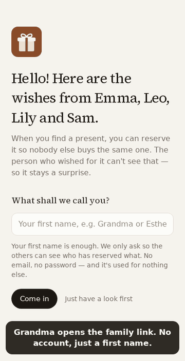
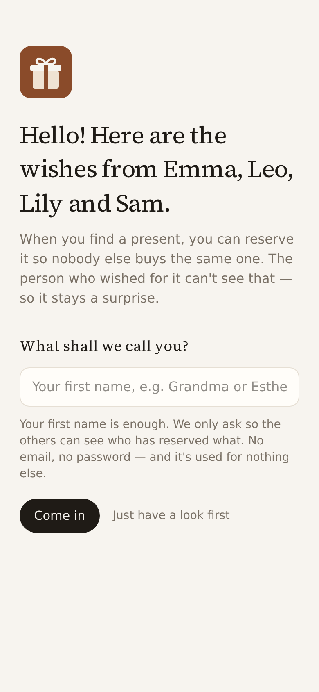
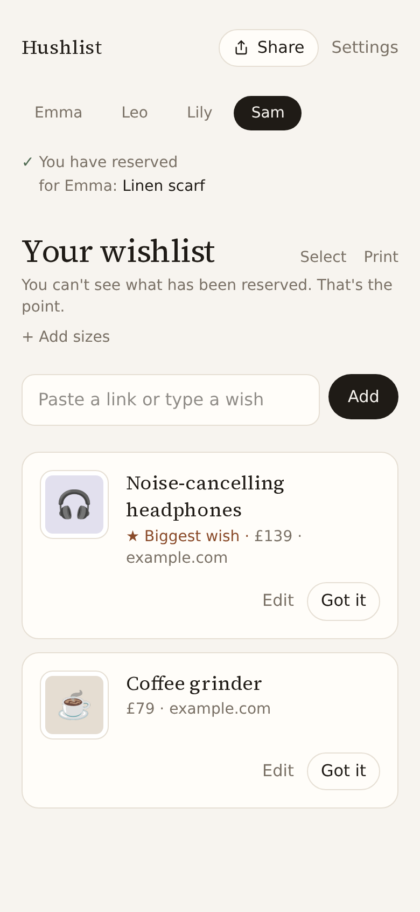

# Hushlist

A small, self-hosted wishlist for one family. Everyone in the household has a
list. Close family reserve gifts through one secret link, so nobody buys the
same thing twice. **Nobody can see what has been reserved on their own list**,
so the surprise holds. That is the hush in the name.

<p align="center">
  
</p>

## Why host your own

A wishlist is a detailed record of a family: names, birthdays, ages, and what
each child wants this year. The people who open it are grandparents, aunts
and friends, who never signed up for anything. Free wishlist services still
have to pay for themselves, and the usual way is through that record.

Take Ønskeskyen (GoWish internationally), the large Danish service. As of
November 2026, by its own documents:

- **You need an account to reserve a gift**, so a grandparent who wants to
  reserve something first has to create a profile [1].
- **Wishlists can become advertising audiences.** The privacy policy says it
  *may* group users aged 18 and over by gender, age, country and the products
  on their wishlist, and make their hashed email addresses available to
  selected media in a "data clean room". The legal basis is legitimate
  interest, so this applies unless you object. With consent, hashed email and
  phone numbers may also go to platforms "such as Facebook, Instagram, Snapchat
  and Google" for retargeting and lookalike audiences [2].
- **Shop links earn commission.** In the app they open in a built-in browser
  that keeps the affiliate click ID and records completed purchases [2].
  TechCrunch reports around 65,000 affiliate partnerships [3].
- **The iOS app's privacy label** lists product interaction under "Data Used
  to Track You" [4]. The Cookiebot declaration on the website lists 19
  marketing cookies, from providers including Meta, Google and TikTok [5].
- **Regulators are looking.** On 13 November 2026, Datatilsynet (the Danish
  Data Protection Agency) and the Agency for Digital Government opened a joint
  supervision of how the service protects minors and handles children's
  data [6]. Forbrugerombudsmanden (the Consumer Ombudsman) has been looking
  into possible hidden advertising through affiliate links since early
  2026 [7]. Neither had published a decision as of 18 November 2026.

None of this is a claim that Ønskeskyen breaks the rules. It is the business
model of a free service, described in its own words. Hushlist is the other
choice. Guests need no account. There are no ads, no affiliate links and no
analytics, and the browser talks to no one but your own server. The list lives on a machine you own.

<sub>Sources, all retrieved 2026-11-18:
[1] [Terms of use](https://onskeskyen.dk/terms-of-use) (effective 5 October 2026) and the FAQ on the same page ·
[2] [Privacy policy](https://onskeskyen.dk/da/privacy-policy), version 5 of 19 September 2026, §3.1.6, §3.1.6.1, §3.1.6.2 and §3.1.14 ·
[3] [TechCrunch, 7 November 2025](https://techcrunch.com/2025/11/07/gowishs-shopping-and-wishlist-app-is-having-its-biggest-year-yet/) ·
[4] [App Store listing](https://apps.apple.com/dk/app/id973421404), App Privacy section ·
[5] The Cookiebot cookie declaration shown on onskeskyen.dk ·
[6] [Datatilsynet, 13 November 2026](https://www.datatilsynet.dk/presse-og-nyheder/nyhedsarkiv/2026/nov/datatilsynet-og-digitaliseringsstyrelsen-indleder-faelles-tilsyn-med-oenskeskyen) ·
[7] [Ritzau via Kristeligt Dagblad, 25 April 2026](https://www.kristeligt-dagblad.dk/danmark/forbrugerombudsmanden-undersoeger-oenskeskyen-mulig-skjult-reklame)</sub>

## What it is

It speaks English and Danish (the household picks one), and adding a language
is one folder of text ([docs/TRANSLATING.md](docs/TRANSLATING.md)). It is a
Next.js app with a SQLite file. It needs no accounts for guests, sends no
mail, has no tracking and makes no calls home.

<p>
  
  
  
</p>

## What it does

- **One list per person.** Adults log in with a name and a code. Children get a
  list that the parents manage, and a login of their own if you want.
- **The family link.** You send one secret link to grandparents, aunts and
  uncles. They type their first name once and can then reserve gifts. They see
  who has taken what, so two people never buy the same gift.
- **The one rule.** On your own list you never see a reservation. The server
  enforces this, and a test covers it (`test/visibility.test.ts`). It is not
  just hidden in the page.
- **Paste a link and the wish fills itself in.** The app reads the title, a
  picture and the price from the shop page. You can also upload your own
  picture, or type a wish without a link.
- **Wish from anywhere.** On an iPhone there is an Apple Shortcut in the share
  sheet. On a computer there is a bookmark ("＋ Wish"). You can also
  paste a whole list at once.
- **Print.** One A4 page per list, for someone without a phone, laid out for
  shopping.
- **"Got it".** When someone receives a wish it moves to a history, grouped by
  Christmas or birthday. Who gave it is only shown a month later.
- **Sizes** per person, **hide** a wish from the others, and a **nightly link
  check** that flags wishes whose shop page is gone or sold out.


## Set it up

**If you use an AI assistant** (Claude Code, Codex, Cursor and the like),
open this repository in it and ask it to set up Hushlist for your family. It
should start with [AGENTS.md](AGENTS.md), which is written for exactly that.

**By hand:** it runs as a Docker container with one data directory, and it can
be hosted however you like. Three worked examples:

| Example | Gives you | You need |
| --- | --- | --- |
| [`deploy/cloudflare-tunnel`](deploy/cloudflare-tunnel) | `https://wishes.your-domain.com`. The app has no open port and no route to your LAN. This is the setup the app runs on at its first home. | A domain on Cloudflare (free plan) |
| [`deploy/tailscale-funnel`](deploy/tailscale-funnel) | `https://wishes.your-tailnet.ts.net`, with the same isolation | A Tailscale account (free plan) |
| [`deploy/lan`](deploy/lan) | `http://your-server:3000`, to try it or to put behind a reverse proxy you already run | Docker |

[docs/HOSTING.md](docs/HOSTING.md) covers what any other setup must provide.
[docs/CONFIGURATION.md](docs/CONFIGURATION.md) covers every setting.

### Try it with a demo family

```sh
npm install
HUSHLIST_DB_PATH=/tmp/demo/hushlist.db npx tsx scripts/seed-demo.ts      # --lang=da for Danish
HUSHLIST_DB_PATH=/tmp/demo/hushlist.db npm run dev
```

The seed script prints a family link and two logins. The screenshots above
come from this demo (`scripts/screenshots.mjs`).

## Develop

```sh
npm install
npm test && npm run typecheck
npm run dev
```

[docs/DESIGN.md](docs/DESIGN.md) explains the decisions behind the app:
roles, the visibility rule, what was left out on purpose, and why.
[docs/SECURITY.md](docs/SECURITY.md) covers the threat model.
[docs/TRANSLATING.md](docs/TRANSLATING.md) covers adding a language.

The app was written in Danish first, and some things still show it: the URL
paths (`/liste`, `/indstillinger`) and Danish text as the reference that every
other language is checked against.

## Licence

MIT, see [LICENSE](LICENSE). The demo pictures are drawn from Noto Color Emoji
(SIL Open Font License). The heading font, Source Serif 4, is downloaded at
build time (SIL Open Font License).
