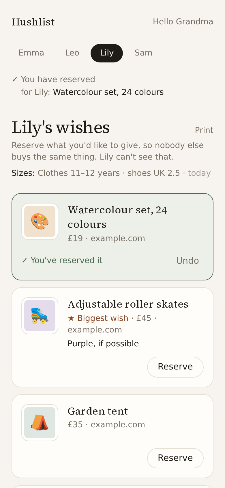
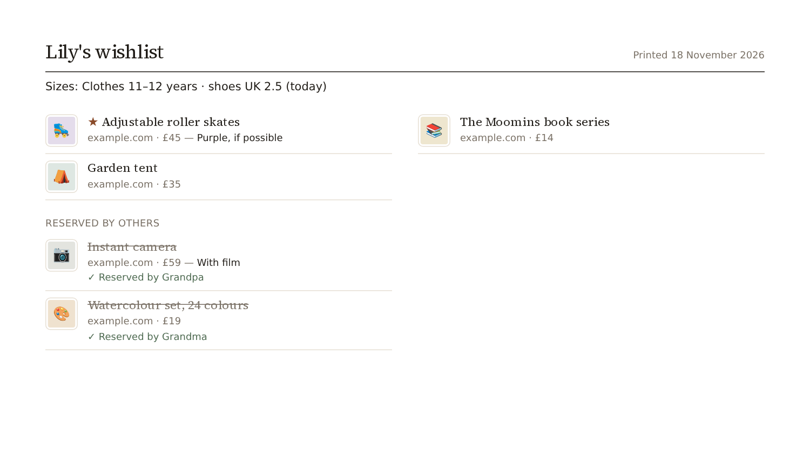

# Hushlist

A small, self-hosted wishlist for one family. Everyone in the household has a
list. Close family reserve gifts through one secret link, so nobody buys the
same thing twice. **Nobody can see what has been reserved on their own list**,
so the surprise holds. That is the hush in the name.

It speaks English and Danish (the household picks one), and adding a language
is one folder of text ([docs/TRANSLATING.md](docs/TRANSLATING.md)). It is a
Next.js app with a SQLite file. It needs no accounts for guests, sends no
mail, has no tracking and makes no calls home.

<p>
  
  
  
</p>

## What it does

- **One list per person.** Adults log in with a name and a code. Children get a
  list that the parents manage, and a login of their own if you want.
- **The family link.** You send one secret link to grandparents, aunts and
  uncles. They type their first name once and can then reserve gifts. They see
  who has taken what, so two people never buy the same gift.
- **The one rule.** On your own list you never see a reservation. The server
  enforces this, and a test covers it (`test/visibility.test.ts`). It is not
  just hidden in the page.
- **Paste a link and the wish fills itself in.** The app reads the title, a
  picture and the price from the shop page. You can also upload your own
  picture, or type a wish without a link.
- **Wish from anywhere.** On an iPhone there is an Apple Shortcut in the share
  sheet. On a computer there is a bookmark ("＋ Wish"). You can also
  paste a whole list at once.
- **Print.** One A4 page per list, for someone without a phone, laid out for
  shopping.
- **"Got it".** When someone receives a wish it moves to a history, grouped by
  Christmas or birthday. Who gave it is only shown a month later.
- **Sizes** per person, **hide** a wish from the others, and a **nightly link
  check** that flags wishes whose shop page is gone or sold out.



## Set it up

**If you use an AI assistant** (Claude Code, Codex, Cursor and the like),
open this repository in it and ask it to set up Hushlist for your family. It
should start with [AGENTS.md](AGENTS.md), which is written for exactly that.

**By hand:** it runs as a Docker container with one data directory, and it can
be hosted however you like. Three worked examples:

| Example | Gives you | You need |
| --- | --- | --- |
| [`deploy/cloudflare-tunnel`](deploy/cloudflare-tunnel) | `https://wishes.your-domain.com`. The app has no open port and no route to your LAN. This is the setup the app runs on at its first home. | A domain on Cloudflare (free plan) |
| [`deploy/tailscale-funnel`](deploy/tailscale-funnel) | `https://wishes.your-tailnet.ts.net`, with the same isolation | A Tailscale account (free plan) |
| [`deploy/lan`](deploy/lan) | `http://your-server:3000`, to try it or to put behind a reverse proxy you already run | Docker |

[docs/HOSTING.md](docs/HOSTING.md) covers what any other setup must provide.
[docs/CONFIGURATION.md](docs/CONFIGURATION.md) covers every setting.

### Try it with a demo family

```sh
npm install
HUSHLIST_DB_PATH=/tmp/demo/hushlist.db npx tsx scripts/seed-demo.ts      # --lang=da for Danish
HUSHLIST_DB_PATH=/tmp/demo/hushlist.db npm run dev
```

The seed script prints a family link and two logins. The screenshots above
come from this demo (`scripts/screenshots.mjs`).

## Develop

```sh
npm install
npm test && npm run typecheck
npm run dev
```

[docs/DESIGN.md](docs/DESIGN.md) explains the decisions behind the app:
roles, the visibility rule, what was left out on purpose, and why.
[docs/SECURITY.md](docs/SECURITY.md) covers the threat model.
[docs/TRANSLATING.md](docs/TRANSLATING.md) covers adding a language.

The app was written in Danish first, and some things still show it: the URL
paths (`/liste`, `/indstillinger`) and Danish text as the reference that every
other language is checked against.

## Licence

MIT, see [LICENSE](LICENSE). The demo pictures are drawn from Noto Color Emoji
(SIL Open Font License). The heading font, Source Serif 4, is downloaded at
build time (SIL Open Font License).
